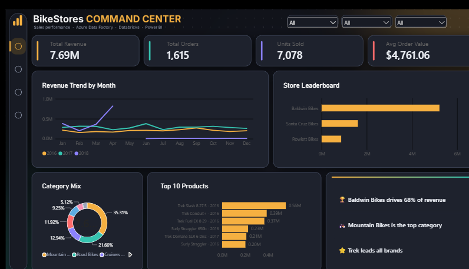
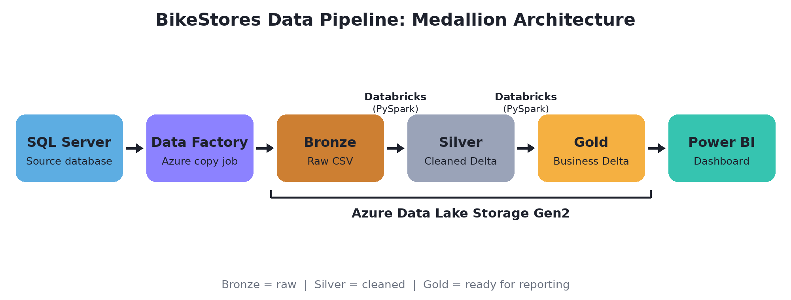

🚲 BikeStores Command Center
An end-to-end Azure data pipeline: SQL Server → Data Factory → Databricks → Power BI

   

📌 At a Glance
💰 Revenue	🧾 Orders	🚲 Units Sold	🛒 Avg Order Value
$7.69M	1,615	7,078	$4,761.06
🏆 Baldwin Bikes generates about 68% of total revenue
🚵 Mountain Bikes is the top category (35.3%), followed by Road Bikes (21.7%)
⭐ Trek leads all brands
📖 Table of Contents
Project Overview
Architecture
Tech Stack
Repository Structure
Data Layers
Dashboard
Key Insights
How to Reproduce
Challenges and Lessons Learned
Article and Author
🎯 Project Overview

BikeStores is a sample retail business with three stores, 1,615 orders and 7,000+ units of bikes and accessories sold between 2016 and 2018. The source data sits in SQL Server across two schemas:

production: brands, categories, products, stocks
sales: customers, orders, order items, staffs, stores

Goal: build the pipeline a real data team would, and answer three business questions:

Which store earns the most?
Which categories and brands drive revenue?
How does revenue change month to month?
🏗 Architecture

  

The pipeline follows the Medallion (multi-hop) architecture. Each hop makes the data cleaner and closer to what the business needs.

Layer	Format	What happens
🥉 Bronze	CSV	Raw data copied from SQL Server by Data Factory, left untouched
🥈 Silver	Delta	Cleaned: snake_case columns, trimmed text, empty strings to null, typed dates, duplicates removed
🥇 Gold	Delta	Business-ready tables, joined and aggregated for reporting

Keeping raw data untouched means any later mistake can be fixed by re-running the layers above it.

🧰 Tech Stack
Area	Tools
Source	SQL Server (BikeStores sample database)
Ingestion	Azure Data Factory
Storage	Azure Data Lake Storage Gen2
Transformation	Azure Databricks, PySpark, Delta Lake
Serving	Databricks SQL Warehouse (serverless)
Visualization	Power BI Desktop, DAX
📁 Repository Structure
bikestores-azure-data-pipeline/
├── bronze/            # Raw CSV exports, one folder per table
├── silver/            # Cleaned Delta tables
├── gold/              # Business-ready Delta tables
├── screenshots/       # Dashboard and architecture images
└── README.md
🗂 Data Layers
🥉 Bronze: raw ingestion

A Data Factory copy activity reads each SQL Server table and writes it as CSV into the data lake, one folder per table. No transformation happens here.

🥈 Silver: cleaned data

One reusable clean() function in PySpark is applied to every table:

python
from pyspark.sql import functions as F

def clean(df):
    # snake_case column names
    for c in df.columns:
        df = df.withColumnRenamed(c, c.strip().lower().replace(" ", "_"))
    # trim text and turn empty strings into nulls
    for c, t in df.dtypes:
        if t == "string":
            df = df.withColumn(c, F.when(F.trim(F.col(c)) == "", None).otherwise(F.trim(F.col(c))))
    # convert date columns
    for c in df.columns:
        if c.endswith("_date"):
            df = df.withColumn(c, F.to_date(F.col(c)))
    return df.dropDuplicates()
🥇 Gold: reporting tables
Table	Purpose
sales_fact	Order items joined with orders, products, categories, brands, customers and stores. Includes revenue = quantity * list_price * (1 - discount)
sales_by_store	Revenue and orders per store
top_products	Best-selling products by revenue
monthly_revenue	Revenue trend by month

Gold tables are saved as Delta tables in the bikestores_gold schema and served to Power BI through a serverless Databricks SQL warehouse.

📊 Dashboard

The Power BI report, the BikeStores Command Center, uses a custom dark theme with gold and teal accents.

Section	What it shows
KPI cards	Total Revenue, Total Orders, Units Sold, Average Order Value
Revenue Trend by Month	Monthly revenue as one line per year (2016, 2017, 2018)
Store Leaderboard	Revenue per store: Baldwin, Santa Cruz, Rowlett
Category Mix	Donut chart of revenue share by category
Top Products	Best-selling products by revenue
Insight panel	Text that updates automatically from DAX measures
Slicers	Three dropdown filters at the top

Example DAX behind the store-share insight:

dax
Top Store Share =
VAR ts = [Top Store]
RETURN
    DIVIDE(
        CALCULATE([Total Revenue], sales_fact[store_name] = ts),
        CALCULATE([Total Revenue], ALL(sales_fact[store_name]))
    )

Data note: the 2018 line stops around April because the dataset ends there.

💡 Key Insights
Metric	Value
Total revenue	about $7.69M
Total orders	1,615
Units sold	7,078
Average order value	$4,761.06
Top store	Baldwin Bikes, about 68% of revenue
Top category	Mountain Bikes, about 35.3%
Second category	Road Bikes, about 21.7%
Top brand	Trek
🚀 How to Reproduce
Restore the source database in SQL Server using the BikeStores sample scripts.
Create an Azure Storage account (hierarchical namespace enabled) with a container named bikestores and three folders: bronzelayer, silverlayer, goldlayer.
Build the Data Factory pipeline: one copy activity per table, SQL Server to CSV in bronzelayer.
Open Azure Databricks, connect to the storage account (use a secret scope, never hard-code keys) and run the Silver and Gold transformations.
Create a SQL warehouse and connect Power BI Desktop with the Azure Databricks connector (Import mode).
Apply the theme, then build the visuals and DAX measures.

🔒 Security note: never commit access keys, Personal Access Tokens or connection strings. Use Databricks secret scopes and keep your storage account name out of public notebooks.

🧠 Challenges and Lessons Learned
Challenge	How it was solved
Storage authentication errors	Used a proper secret scope and re-defined variables after every cluster restart
Wrong file paths	Listed the real folder layout with dbutils.fs.ls before reading
Cloud cost	Removed Azure Synapse from the design; Databricks SQL serves Gold directly to Power BI
Insight showing 100%	Stored the top store in a VAR before calculating its share
Lost unsaved report	Now saving Power BI work often (Ctrl+S)
✍️ Article and Author

📝 Read the full walkthrough on Medium: add your Medium article link here

Aqsa Fatima Data Engineering and Analytics student

⭐ If you found this project useful, consider giving the repository a star.

